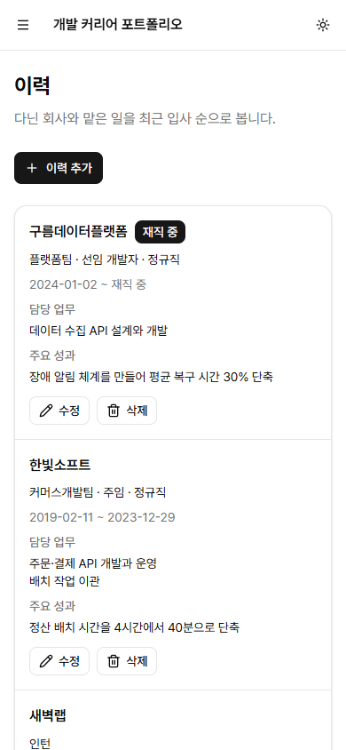
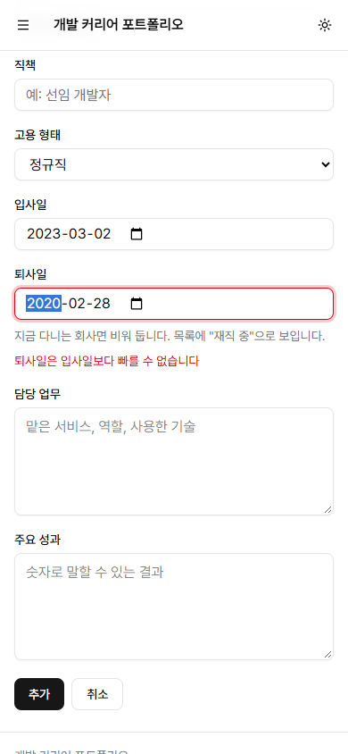
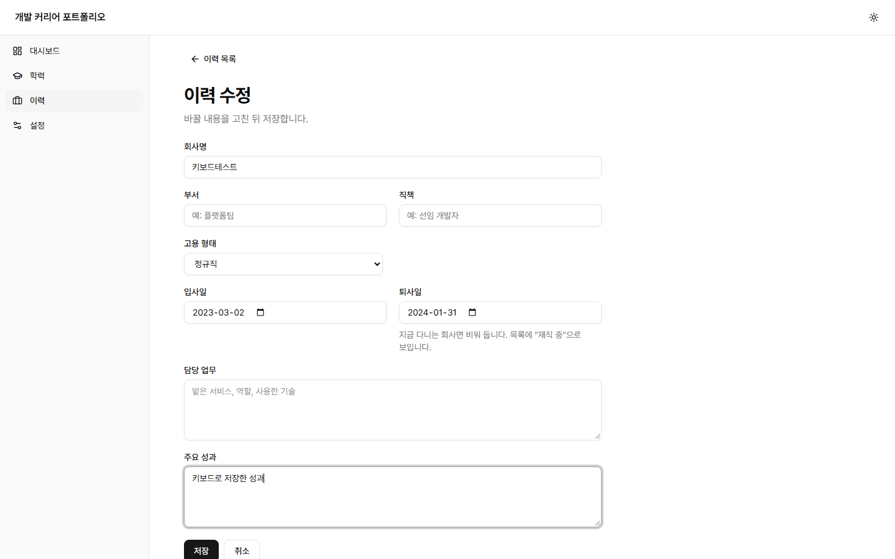
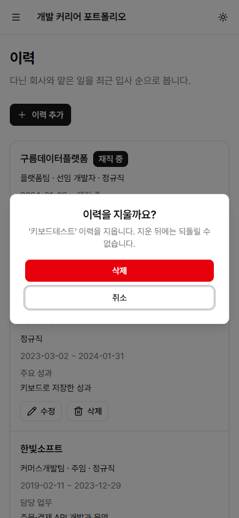

# #41 이력(경력) 등록·수정·삭제 화면

이슈: <https://github.com/sirloinbh/dev-career-portfolio/issues/41> (상위 이슈 #67 이력서 항목 화면)

## 목적

이력을 화면에서 등록·수정·삭제합니다. #39 학력 입력 폼과 같은 구조입니다. 남은 항목(프로젝트·스킬·자격증) 폼도 같은 코드를 쓰도록, 학력 폼 안에 있던 공통 부분을 모듈로 꺼냈습니다.

## 변경

- `frontend/src/careers.tsx`: 목록에 "이력 추가" 버튼과 항목별 수정·삭제, `NewCareer`, `EditCareer`, 입력 폼 `CareerFields`. 목록은 삭제 뒤 행을 유지하는 `useReloading`으로 바꿨습니다.
- `frontend/src/career-data.ts`: 폼 상태 타입과 변환(`toCareerForm`, `toCareerInput`), 서버 오류 문구를 칸별로 나누는 `careerFieldErrors`, `careerApi.create/update/remove`.
- `frontend/src/app.tsx`: `/careers/new`, `/careers/:id/edit` 경로와 `careerPaths`.
- 학력 폼에서 꺼낸 공통 모듈(학력 화면도 이것을 씁니다. 동작은 같고 기존 학력 테스트 28건이 그대로 통과합니다):
  - `frontend/src/field-errors.ts`: `splitFieldErrors` — 서버 메시지를 칸별로 나누고 화면 순서로 정렬. 학력의 `fieldErrors`는 이 함수에 학력 항목 이름만 넘깁니다.
  - `frontend/src/form-state.tsx`: `useServerForm` — 저장 중 상태, 칸별 오류와 `aria-invalid`·`aria-describedby`, 가장 위 오류 칸으로 포커스, 칸이 없는 메시지는 폼 아래 `Notice`와 저장 버튼 포커스, 저장·취소 버튼.
  - `frontend/src/delete-item.ts`: `deleteItem` — 삭제 결과를 toast로 알리고, 이미 없는 행(404)은 지운 것으로 보고, 다른 실패는 확인 창을 연 채 둡니다. 목적격 조사(학력을·프로젝트를)를 이름에 맞춰 붙입니다.
- `frontend/src/career-form.test.tsx`: 메모리 안의 가짜 API로 등록·수정·삭제·오류 표시를 검사합니다(처음 14건, 1차 리뷰 반영 뒤 15건).

## 판단한 내용

- **재직 중:** #32 결정대로 퇴사일이 비어 있으면 재직 중입니다. 따로 "재직 중" 체크 칸을 두지 않았습니다. 체크를 풀고 퇴사일을 비워도 결국 재직 중으로 저장되어 두 칸이 어긋날 수 있기 때문입니다. 대신 퇴사일 칸 아래에 "지금 다니는 회사면 비워 둡니다. 목록에 "재직 중"으로 보입니다."를 두고 `aria-describedby`로 칸과 묶었습니다. 수정에서 퇴사일을 지우면 재직 중으로 바뀝니다.
- **검증은 서버가 합니다(#39와 같음).** 폼은 `noValidate`이고, 서버의 한국어 메시지를 칸 아래에 보입니다. 고용 형태 메시지 안의 쉼표("정규직, 계약직, …")는 한 메시지로 남습니다.
- **입력 칸:** 회사명·부서·직책은 100자, 담당 업무·주요 성과는 2000자로 `maxLength`를 서버 한도와 맞췄습니다. 고용 형태는 학력과 같이 네이티브 `select`입니다.

## 검증

- `TEST_DATABASE_URL`=`career_test`로 `npm run check`: 통과(종료 코드 0). 백엔드 78건 통과·건너뜀 0건, 프론트엔드 110건 통과·2건 건너뜀(기존 테마 조건부 테스트, 새 이력 폼 테스트 14건 포함), 스킬 검사 4건 통과, 빌드 통과. `npm run knip`: 통과.
- 실제 브라우저: 설치된 Chrome(헤드리스 156)을 DevTools 프로토콜로 조작했습니다. 개발 서버(API 3108, Vite 5208)를 이 PC의 Docker PostgreSQL 17 `career_test`에 붙이고, 지어낸 이력 3건으로 시작했습니다. 모든 단계는 마우스 없이 키 입력(`Tab`, `Enter`, `Escape`, 숫자·화살표 키)만으로 했습니다. 날짜 칸은 연도 → 오른쪽 화살표 → 월 → 오른쪽 화살표 → 일 순서로 쳤습니다.

키보드 흐름(390×844, 1440×900 모두 같은 결과):

| 단계                                                        | 결과                                                                                                  |
| ----------------------------------------------------------- | ----------------------------------------------------------------------------------------------------- |
| 목록에서 `Tab`으로 "이력 추가" → `Enter`                    | `/careers/new`로 이동                                                                                 |
| 회사명, 입사일 2023-03-02, 퇴사일 2020-02-28 입력 후 "추가" | 퇴사일 칸 아래 "퇴사일은 입사일보다 빠를 수 없습니다", `aria-invalid`, 포커스가 퇴사일로, 입력값 유지 |
| 퇴사일을 2024-01-31로 고쳐 "추가"                           | 목록으로 돌아가 "이력 4건", 새로고침 뒤에도 유지                                                      |
| "키보드테스트 수정" → 주요 성과 입력 → "저장" → 새로고침    | 주요 성과가 저장된 채 유지                                                                            |
| "키보드테스트 삭제" → 확인 창 → `Escape`                    | 창이 닫히고 포커스가 삭제 버튼으로 돌아옴, "이력 4건", 새로고침 뒤에도 4건                            |
| 다시 "키보드테스트 삭제" → 창의 "삭제" → `Enter`            | "이력 3건", 포커스가 페이지 제목(`h1`)으로, 새로고침 뒤에도 3건                                       |

두 크기 모두 목록과 오류가 난 폼에서 가로 넘침이 없고, 보이는 글자는 최소 14px입니다.

| 목록 390                                 | 오류가 난 폼 390                               | 수정 폼 1440                               | 삭제 확인 390                                          |
| ---------------------------------------- | ---------------------------------------------- | ------------------------------------------ | ------------------------------------------------------ |
|  |  |  |  |

## 1차 리뷰 반영

읽기 전용 리뷰 에이전트가 PR 전체 diff를 봤습니다. 학력 폼을 공통 모듈로 옮긴 부분은 동작이 같다고 확인했고(학점 안내 id, `clearError`, toast 문구 포함), 다음 세 가지를 짚었습니다. 모두 이 PR에서 고쳤습니다.

- **(중간) 일부만 입력한 퇴사일이 재직 중으로 저장됨:** 날짜 칸에 연도·월만 치면(`2023-12-__`) 브라우저는 값을 `''`로 읽고 `validity.badInput`만 켭니다. 퇴사일은 비면 재직 중이라 오류 없이 저장됐습니다. 학력의 졸업일도 같았습니다(비면 졸업일 없음). `form-state.tsx`에 `typedDate`를 두어, 이런 칸은 서버가 거절하는 글자(`incomplete`)로 보내고 서버의 "퇴사일은(는) YYYY-MM-DD 형식의 날짜여야 합니다"가 칸 아래 보이게 했습니다. 이력 퇴사일과 학력 졸업일에 씁니다. 입사일·입학일은 필수라 빈 값이 이미 서버에서 거절됩니다.
- **(낮음) 404 삭제 테스트가 약함:** 성공 toast("'한빛소프트' 이력을 지웠습니다")가 보이고 "지우지 못했습니다"가 없는지 확인하도록 보강했습니다.
- **(낮음) 학점 안내 연결 테스트 없음:** 학점·만점 칸이 "학점과 만점은 함께 넣거나 함께 비워 둡니다" 안내로 설명되는지 확인하는 테스트를 추가했습니다.

검증:

- 새 테스트 3건(이력 퇴사일, 학력 졸업일, 학점 안내). `typedDate`가 값을 그대로 돌려주게 바꾸면 날짜 테스트 2건이 실패하고, 되돌리면 통과하는 것을 확인했습니다.
- 실제 브라우저(헤드리스 Chrome 156, 390×844): 퇴사일과 졸업일에 연도·월만 키로 치고 "추가"를 누르면 `value: ''`, `badInput: true`인 상태로 보내져, 칸 아래 "퇴사일은(는) YYYY-MM-DD 형식의 날짜여야 합니다"(학력은 "졸업일은(는) …")가 보이고 포커스가 그 칸으로 갔습니다. 행은 저장되지 않았습니다.
- `TEST_DATABASE_URL`=`career_test`로 `npm run check`: 통과. 백엔드 78건 통과·건너뜀 0건, 프론트엔드 113건 통과·2건 건너뜀, 스킬 검사 4건 통과, 빌드 통과. `npm run knip`: 통과.

## 2차 리뷰 반영

2차 리뷰는 1차 지적 세 가지가 맞게 고쳐졌다고 확인했습니다. 서버는 `incomplete`를 형식 오류로 거절하고(`abort`라 다른 오류가 겹치지 않음), 메시지는 퇴사일·졸업일 칸으로 갑니다. 새로 짚은 것은 두 가지이고, 이 PR에서 고쳤습니다.

- **(중간) 졸업일을 일부만 친 뒤 재학 중을 고르면 저장이 막힘:** 재학 중은 졸업일을 비우고 잠그지만, 일부만 친 칸은 이미 값이 `''`라 React가 칸을 건드리지 않습니다. 잠긴 칸이 `badInput`을 그대로 보고해 `incomplete`가 보내졌고, 잠긴 칸 아래 오류가 보였습니다(실제 브라우저에서 재현: `disabled: true`, `badInput: true`, 저장 거절). `typedDate`는 잠긴 칸은 값을 그대로 보내고, 재학 중을 고르면 날짜 칸도 직접 비웁니다.
- **(낮음) 문서의 이력 폼 테스트 수:** 14건 → 15건으로 고쳤습니다.

검증:

- 새 테스트 1건(졸업일 일부 입력 → 재학 중 → `endDate: null`로 저장). 잠긴 칸 확인을 빼면 실패하고, 되돌리면 통과합니다.
- 실제 브라우저(헤드리스 Chrome 156, 390×844): 졸업일에 연도·월만 치고 상태를 키보드로 재학 중으로 바꾸면 칸이 비고 `badInput: false`가 되며, "추가" 뒤 목록으로 돌아가 재학 중·졸업일 없음으로 저장됐습니다. 확인용 행은 지웠습니다.
- `TEST_DATABASE_URL`=`career_test`로 `npm run check`: 통과. 백엔드 78건 통과·건너뜀 0건, 프론트엔드 114건 통과·2건 건너뜀, 스킬 검사 4건 통과, 빌드 통과. `npm run knip`: 통과.
