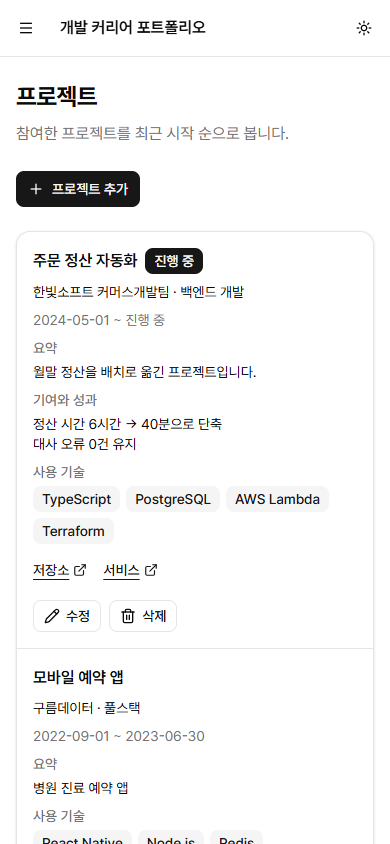
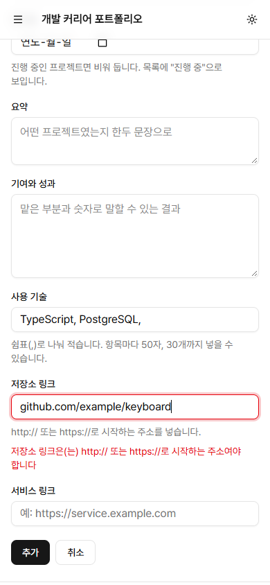
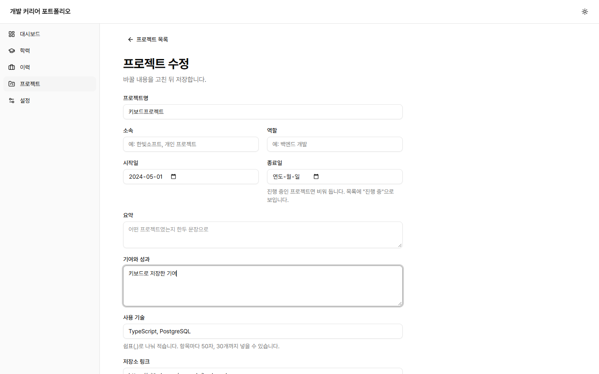
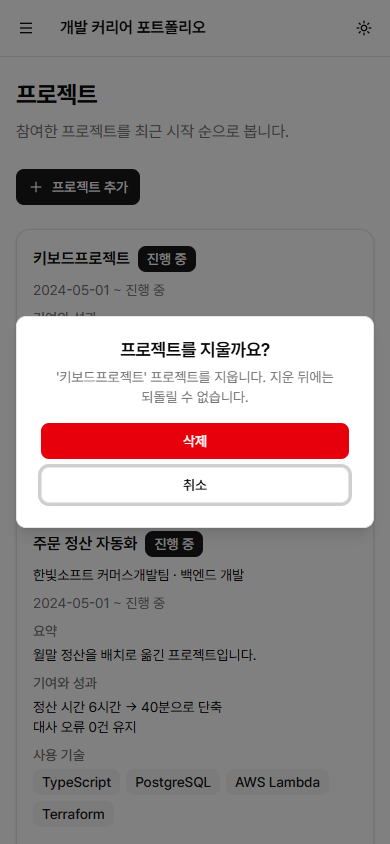

# #43 프로젝트 등록·수정·삭제 화면

이슈: <https://github.com/sirloinbh/dev-career-portfolio/issues/43> (상위 이슈 #67 이력서 항목 화면)

## 목적

프로젝트를 화면에서 등록·수정·삭제합니다. #41에서 꺼낸 공통 폼 모듈(`form-state.tsx`, `field-errors.ts`, `delete-item.ts`)을 그대로 씁니다.

## 변경

- `frontend/src/projects.tsx`: 목록에 "프로젝트 추가" 버튼과 항목별 수정·삭제, `NewProject`, `EditProject`, 입력 폼 `ProjectFields`. 목록은 삭제 뒤 행을 유지하는 `useReloading`으로 바꿨습니다.
- `frontend/src/project-data.ts`: 폼 상태 타입과 변환(`toProjectForm`, `toProjectInput`, `splitTechnologies`), 서버 오류 문구를 칸별로 나누는 `projectFieldErrors`, `projectApi.create/update/remove`.
- `frontend/src/app.tsx`: `/projects/new`, `/projects/:id/edit` 경로와 `projectPaths`.
- `frontend/src/field-errors.ts`: 같은 칸에 같은 메시지가 여러 번 오면 한 번만 보입니다. 서버는 목록의 항목마다 오류를 하나씩 내므로, 50자를 넘는 기술 이름이 둘이면 "사용 기술 항목은 50자 이하여야 합니다"가 두 번 옵니다.
- `frontend/src/project-form.test.tsx`: 메모리 안의 가짜 API로 등록·수정·삭제·오류 표시를 검사합니다(15건).
- `frontend/src/projects.test.tsx`: 목록에 수정 링크가 생겨, 외부 링크 검사는 "새 탭" 링크로 좁혔습니다.

## 판단한 내용

- **진행 중:** #33 결정대로 종료일이 비어 있으면 진행 중입니다. 종료일 칸 아래 "진행 중인 프로젝트면 비워 둡니다. 목록에 "진행 중"으로 보입니다."를 `aria-describedby`로 묶었고, 일부만 친 종료일은 #41과 같이 서버가 형식 오류로 거절합니다.
- **사용 기술:** 쉼표로 나눠 적는 한 줄 입력입니다. 태그를 하나씩 더하는 입력은 키보드·화면 낭독기 동작을 따로 만들어야 하지만, 한 줄 입력은 일반 칸과 같이 쓰고 고칠 수 있습니다. 앞뒤 공백은 지우고, 쉼표가 겹치거나 끝에 남아 생긴 빈 조각은 버립니다. 50자·30개·중복 검사는 서버가 하고 메시지를 칸 아래에 보입니다. 이름 안에 쉼표가 있는 기술은 넣을 수 없습니다.
- **링크:** `type="url"`이라 휴대폰에서 주소 자판이 뜨고, 자동 대문자·맞춤법 고치기를 껐습니다. 형식 검사는 서버가 합니다(`noValidate`). 저장소 링크 아래에 "http:// 또는 https://로 시작하는 주소를 넣습니다."를 둡니다.
- **입력 칸 한도:** 프로젝트명·소속·역할 100자, 요약 500자, 기여와 성과 2000자, 링크 500자로 `maxLength`를 서버 한도와 맞췄습니다. 사용 기술 칸은 50자 30개와 구분자가 들어가도록 1600자입니다.

## 검증

- `TEST_DATABASE_URL`=`career_test`로 `npm run check`: 통과(종료 코드 0). 백엔드 78건 통과·건너뜀 0건, 프론트엔드 140건 통과·2건 건너뜀(기존 테마 조건부 테스트, 새 프로젝트 폼 테스트 15건 포함), 스킬 검사 4건 통과, 빌드 통과. `npm run knip`: 통과. 같은 메시지 합치기를 빼면 해당 테스트가 실패하는 것도 확인했습니다.
- 실제 브라우저: 설치된 Chrome(헤드리스 156)을 DevTools 프로토콜로 조작했습니다. 개발 서버(API 3108, Vite 5208)를 이 PC의 Docker PostgreSQL 17 `career_test`에 붙이고, 지어낸 프로젝트 3건으로 시작했습니다. 모든 단계는 마우스 없이 키 입력(`Tab`, `Enter`, `Escape`, `Ctrl+A`, 글자·숫자·화살표 키)만으로 했습니다.

키보드 흐름(390×844, 1440×900 모두 같은 결과):

| 단계                                                                                                          | 결과                                                                                                                                      |
| ------------------------------------------------------------------------------------------------------------- | ----------------------------------------------------------------------------------------------------------------------------------------- |
| 목록에서 `Tab`으로 "프로젝트 추가" → `Enter`                                                                  | `/projects/new`로 이동                                                                                                                    |
| 프로젝트명, 시작일 2024-05-01, 사용 기술 "TypeScript, PostgreSQL,", 저장소 링크 `github.com/…` 입력 후 "추가" | 저장소 링크 칸 아래 "저장소 링크은(는) http:// 또는 https://로 시작하는 주소여야 합니다", `aria-invalid`, 포커스가 그 칸으로, 입력값 유지 |
| `Ctrl+A`로 주소를 고쳐 `https://…`로 "추가"                                                                   | 목록으로 돌아가 "프로젝트 4건", 새로고침 뒤에도 유지. 사용 기술은 끝 쉼표 없이 TypeScript·PostgreSQL 두 개                                |
| "키보드프로젝트 수정" → 사용 기술 칸이 "TypeScript, PostgreSQL" → 기여와 성과 입력 → "저장" → 새로고침        | 기여와 성과가 저장된 채 유지                                                                                                              |
| "키보드프로젝트 삭제" → 확인 창 → `Escape`                                                                    | 창이 닫히고 포커스가 삭제 버튼으로 돌아옴, "프로젝트 4건", 새로고침 뒤에도 4건                                                            |
| 다시 "키보드프로젝트 삭제" → 창의 "삭제" → `Enter`                                                            | "프로젝트 3건", 포커스가 페이지 제목(`h1`)으로, 새로고침 뒤에도 3건                                                                       |

두 크기 모두 목록과 오류가 난 폼에서 가로 넘침이 없고, 보이는 글자는 최소 14px입니다.

| 목록 390                                  | 오류가 난 폼 390                                | 수정 폼 1440                                | 삭제 확인 390                                           |
| ----------------------------------------- | ----------------------------------------------- | ------------------------------------------- | ------------------------------------------------------- |
|  |  |  |  |
