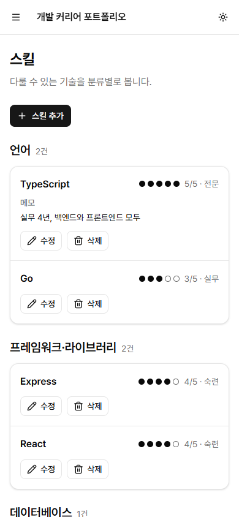
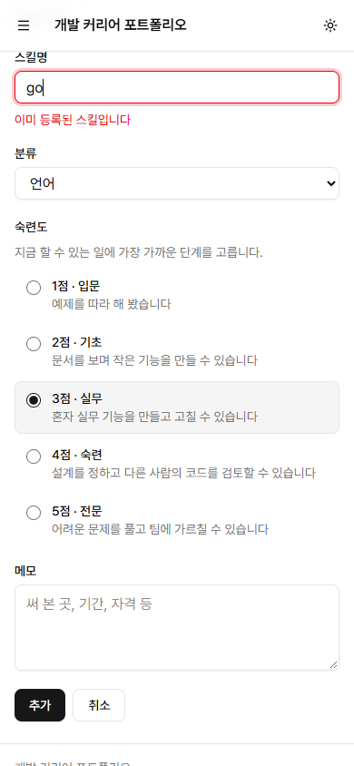
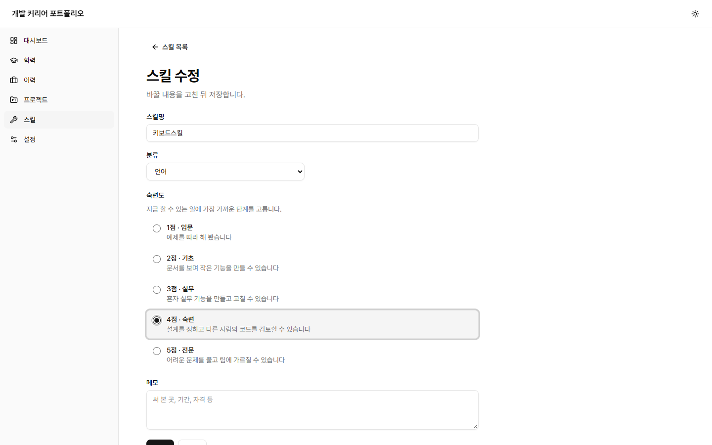
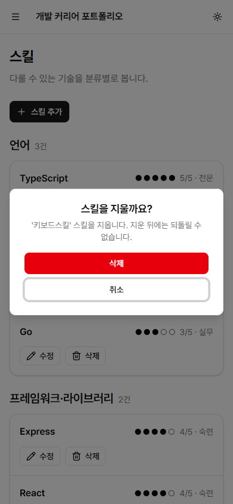

# #45 스킬 등록·수정·삭제 화면

이슈: <https://github.com/sirloinbh/dev-career-portfolio/issues/45> (상위 이슈 #67 이력서 항목 화면)

## 목적

스킬을 화면에서 등록·수정·삭제합니다. #41에서 꺼낸 공통 폼 모듈을 그대로 쓰고, #34에서 미룬 숙련도 단계별 기준 문구를 정합니다.

## 변경

- `frontend/src/skills.tsx`: 목록에 "스킬 추가" 버튼과 항목별 수정·삭제, `NewSkill`, `EditSkill`, 입력 폼 `SkillFields`. 목록은 삭제 뒤 행을 유지하는 `useReloading`으로 바꿨고, 숙련도 옆에 단계 이름("4/5 · 숙련")을 보입니다.
- `frontend/src/skill-data.ts`: 숙련도 단계 `proficiencyLevels`와 `proficiencyName`, 폼 상태 타입과 변환(`toSkillForm`, `toSkillInput`), 서버 오류 문구를 칸별로 나누는 `skillFieldErrors`, `skillApi.create/update/remove`. 분류 목록 `skillCategories`는 폼이 쓰므로 다시 내보냅니다.
- `frontend/src/form-state.tsx`: 400과 함께 409도 칸별로 나눕니다. 409 "이미 등록된 스킬입니다"를 스킬명 칸 아래에 보이기 위해서입니다. 학력·이력·프로젝트 API는 409를 내지 않아 동작이 같습니다.
- `frontend/src/app.tsx`: `/skills/new`, `/skills/:id/edit` 경로와 `skillPaths`.
- `frontend/src/skill-form.test.tsx`: 메모리 안의 가짜 API로 등록·수정·삭제·오류 표시를 검사합니다(12건). `skills.test.tsx`는 단계 이름이 붙은 숙련도 문장에 맞췄습니다.

## 판단한 내용

- **숙련도 기준(#45 이슈 코멘트로 확정):** 사용자가 선택지는 추천안으로 정해 달라고 해, 아래 추천안으로 정했습니다. 문구만 바뀌므로 바꾸고 싶으면 `proficiencyLevels`만 고치면 됩니다.

| 점수 | 이름 | 기준                                                |
| ---- | ---- | --------------------------------------------------- |
| 1    | 입문 | 예제를 따라 해 봤습니다                             |
| 2    | 기초 | 문서를 보며 작은 기능을 만들 수 있습니다            |
| 3    | 실무 | 혼자 실무 기능을 만들고 고칠 수 있습니다            |
| 4    | 숙련 | 설계를 정하고 다른 사람의 코드를 검토할 수 있습니다 |
| 5    | 전문 | 어려운 문제를 풀고 팀에 가르칠 수 있습니다          |

- **숙련도 입력:** 다섯 단계의 네이티브 라디오 버튼을 `fieldset`·`legend`("숙련도")로 묶었습니다. 화살표 키로 단계를 옮기고, 각 단계의 이름과 기준이 라디오 이름에 들어 있어 화면 낭독기가 함께 읽습니다. 안내 문구와 서버 메시지는 `fieldset`의 `aria-describedby`로 묶었습니다. 라디오는 `aria-invalid`를 지원하지 않아 붙이지 않았습니다. 새 스킬은 단계를 미리 골라 두지 않고, 고르지 않고 저장하면 서버의 "숙련도는 1~5 사이의 정수여야 합니다"가 보이며 포커스가 첫 단계로 갑니다.
- **중복 이름:** 서버는 대소문자를 무시하고 이름 중복을 409로 거절합니다(#34). 이 메시지를 스킬명 칸 아래에 보이고 포커스를 그 칸으로 옮깁니다.
- **분류:** 학력·이력과 같이 네이티브 `select`이고, 새 스킬은 "언어"로 시작합니다.

## 검증

- `TEST_DATABASE_URL`=`career_test`로 `npm run check`: 통과(종료 코드 0). 백엔드 78건 통과·건너뜀 0건, 프론트엔드 165건 통과·2건 건너뜀(기존 테마 조건부 테스트, 새 스킬 폼 테스트 12건 포함), 스킬 검사 4건 통과, 빌드 통과. `npm run knip`: 통과.
- 실제 브라우저: 설치된 Chrome(헤드리스 156)을 DevTools 프로토콜로 조작했습니다. 개발 서버(API 3108, Vite 5208)를 이 PC의 Docker PostgreSQL 17 `career_test`에 붙이고, 지어낸 스킬 8건(Go 포함)으로 시작했습니다. 모든 단계는 마우스 없이 키 입력(`Tab`, `Enter`, `Escape`, `Ctrl+A`, 화살표·글자 키)만으로 했습니다.

키보드 흐름(390×844, 1440×900 모두 같은 결과):

| 단계                                                                      | 결과                                                                                      |
| ------------------------------------------------------------------------- | ----------------------------------------------------------------------------------------- |
| 목록에서 `Tab`으로 "스킬 추가" → `Enter`                                  | `/skills/new`로 이동                                                                      |
| 스킬명 "go"(이미 있는 Go와 대소문자만 다름), 숙련도 첫 단계에서 `↓` 두 번 | 3점이 골라짐                                                                              |
| "추가"                                                                    | 스킬명 칸 아래 "이미 등록된 스킬입니다", `aria-invalid`, 포커스가 스킬명으로, 입력값 유지 |
| `Ctrl+A`로 이름을 "키보드스킬"로 고쳐 "추가"                              | 목록으로 돌아가 "스킬 9건", 새로고침 뒤 "3/5 · 실무"                                      |
| "키보드스킬 수정" → 골라진 3점에서 `↓` → "저장" → 새로고침                | "4/5 · 숙련", 화면 낭독기 문장 "숙련도 5점 중 4점, 숙련"                                  |
| "키보드스킬 삭제" → 확인 창 → `Escape`                                    | 창이 닫히고 포커스가 삭제 버튼으로 돌아옴, 새로고침 뒤에도 9건                            |
| 다시 "키보드스킬 삭제" → 창의 "삭제" → `Enter`                            | "스킬 8건", 포커스가 페이지 제목(`h1`)으로, 새로고침 뒤에도 8건                           |

두 크기 모두 목록과 오류가 난 폼에서 가로 넘침이 없고, 보이는 글자는 최소 14px입니다.

| 목록 390                                | 오류가 난 폼 390                              | 수정 폼 1440                              | 삭제 확인 390                                         |
| --------------------------------------- | --------------------------------------------- | ----------------------------------------- | ----------------------------------------------------- |
|  |  |  |  |
